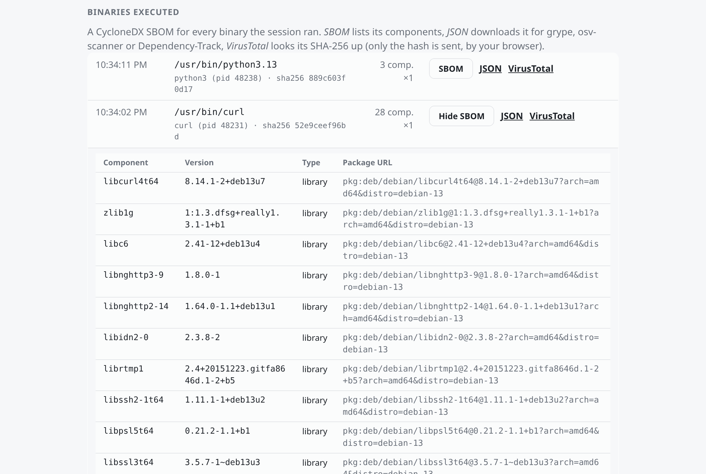

# secwrap

Run a command, or a whole shell, under eBPF watch: record what it does on the network and on the file system, block
the network, or pause each new connection, file write and sensitive read until you say yes.

```sh
go install github.com/noboruma/secwrap/cmd/secwrap@latest
```

or

```sh
curl -fsSL -o secwrap "https://github.com/noboruma/secwrap/releases/latest/download/secwrap-linux-amd64"
chmod +x secwrap
sudo ./secwrap shell
```

or build it with `make` (regenerates the eBPF objects; needs clang and libbpf-dev) or
`go build -o secwrap ./cmd/secwrap`, or download the binaries in the
[Github release section](https://github.com/noboruma/secwrap/releases/latest).


## Features

Pick **what to watch**, and **what to do** with each, with `--net`, `--filesystem` and `--exec`: `log`, `ask`, `deny`
or `off` (e.g. `--net ask --filesystem log`), plus `--sbom`. Given bare (`--net`), a category logs, or does what
`--ask`/`--deny` say (`--net --filesystem --ask`); `shell` turns on `--net --filesystem --ask`. Children are
followed before they run any code. Under `sudo`, the command runs as you, with your groups and `HOME`; `--user NAME`
runs it as someone else, `--as-root` keeps root.

The session ends with the command: background processes it left are stopped (listed by name), so exiting a `shell`
closes everything. `--wait` keeps monitoring them until they exit instead. The summary is in the session's
[history](#history); `--summary` also prints it at the end.

| Feature | Flags | Notes |
| --- | --- | --- |
| Network | `--net` | TCP connect/accept and UDP sends (DNS, QUIC) of the whole process tree, per process |
| Files | `--filesystem` | Every open, with its full path; writes and [sensitive reads](#files) shown live |
| Programs | `--exec` | Every program executed, see [Programs](#programs) |
| Block | `--net deny`, `--deny` | Refused in the kernel, every attempt recorded: all network (`--net`), writes and sensitive reads (`--filesystem`), every program but the launched one (`--exec`) |
| Ask | `--net ask`, `--ask` | The call waits inside the kernel for your Yes/No, right in the terminal (`--answer inline`, the default) and from `secwrap session` (attach or the [web page](#web-page)); `--answer detached` leaves the terminal alone. See [Asking](#asking) |
| Web page | on by default, `--web-addr ADDR`, `--no-web` | One page for every session, alive or dead, on `127.0.0.1:9000` or any other address; one secwrap serves each address, the others take over when it exits |
| Sessions | `secwrap session`, `list`, `attach`, `delete` | Every run is a session, alive or dead, that others can see and answer without a connection to it, see [Sessions](#sessions) |
| Folder rules | `--allow rwx:DIR`, `f`, *Allow folder* | Reads, writes and/or execs under a folder need no answer; each kind stays separate |
| SBOM per binary | `--sbom [DIR]` | A CycloneDX SBOM for every binary the session runs, listed on the web page with a VirusTotal link, see [SBOMs](#sboms) |
| Shell | `secwrap shell` | Your login shell, with everything typed in it monitored, see [Shell](#shell) |
| Login shell | `chsh` | Make a user's whole session monitored, also [in Docker](#in-docker) |
| Attach | `secwrap attach PID…` | Running processes and their children (recording and `--deny`; no asking) |
| Whole host | `monitor --all` | Every process, recording only |
| History | `--history DIR`, `--history off` | Every session in its own folder: events, report, summary, SBOMs, see [History](#history) |
| Live log | `--log FILE`, `--log off` | Text, or JSON lines if FILE ends in `.json`/`.jsonl`. Default: stderr |
| Report | `-o FILE` | JSON report of every endpoint and path; for `run` and `sbom`, the SBOM |
| SBOM of a file | `secwrap sbom BIN` | Go modules, Rust crates (cargo-auditable), shared libraries, dpkg packages |

```sh
sudo ./secwrap monitor --net --filesystem -o report.json -- ./mybinary          # record
sudo ./secwrap monitor --net --deny -- curl -s https://example.com              # offline
sudo ./secwrap monitor --exec --deny -- ./mybinary                              # can't start anything else
sudo ./secwrap monitor --net ask --filesystem log -- ./installer.sh            # ask about the network, log files
sudo ./secwrap monitor --net --filesystem --exec --ask -- ./installer.sh        # ask about everything, here
sudo ./secwrap monitor --net --ask --answer detached -- ./installer.sh          # ask; answer from elsewhere:
sudo ./secwrap session attach                                                   #   in another terminal,
sudo ./secwrap session                                                          #   or the TUI (or the web page)
sudo ./secwrap shell --sbom ~/sboms                    # ask inline (or on its web page), SBOM every binary
sudo ./secwrap attach --net --filesystem --name nginx --duration 5m --log nginx.jsonl
```


## Asking

With `--ask`, a new IP:port (`--net`), a write or sensitive read (`--filesystem`) or a program (`--exec`) pauses the
calling thread until you answer. Enter, or anything but yes, denies; the call then fails with `EPERM`. Answers last for
the session (on the web page, *Forget* takes one back), and concurrent calls to the same peer or file share one question.

```
[ask] Allow curl (pid 4242) udp udp_send to 127.0.0.53:53? [y/N]  (Y = any port on this IP, D = never this IP)
[ask] Allow python3 (pid 4242) to WRITE /home/me/project/out.txt? [y/N/f]  (f = every write under a folder)
[ask] Allow sh (pid 4242) to EXEC /usr/bin/curl (curl -fsSL https://get.example.sh)? [y/N/f]  (f = every exec under a folder)
```

`f` (or *Allow folder* on the page) allows every read, write or exec (the kind asked about) under the file's parent or
any ancestor but `/`; requests already waiting below it are answered at once. `--allow` does it up front:
`--allow r:~/.oh-my-zsh`, `--allow rw:./build`, `--allow x:/usr/bin` (`~/` is expanded even after `r:`).
`--answer inline` asks on `/dev/tty`, not the target's stdin, and borrows it for each question: the command's tree is
frozen (cgroup v2 freezer, invisible to it and to a shell's job control), secwrap takes the foreground, sets the
terminal to line mode, drops typed-ahead input, asks, then puts everything back and thaws (a full-screen program or
the shell prompt gets `SIGWINCH` to redraw). Freezing needs Linux 5.19+ and cgroup v2; without them `monitor`/`run`
ask without freezing, and `shell` leaves its questions to the web page and attach. With no terminal, everything is
denied. `--answer detached` never touches the terminal. Only launched commands can
be asked about: seccomp can't be added to a running process. The target runs with `no_new_privs`, so setuid binaries
inside it (sudo, ping) don't gain privileges.

secwrap re-execs itself in the child, installs a seccomp filter turning `connect`, `sendto`, `sendmsg`, `sendmmsg`
(`--net`), `open`, `openat`, `openat2`, `creat` (`--filesystem`) and `execve`, `execveat` (`--exec`) into
`SECCOMP_RET_USER_NOTIF`, takes the listener and
execs the target, which never holds it. For each call it reads the address or path from the target's memory, resolves
it as the kernel will (cwd, dirfd, `..`, symlinks, `/proc/self`), asks, and stores a Yes in a BPF map.

**The kernel enforces, not seccomp.** The cgroup hooks and the LSM programs check what the kernel actually
uses against those maps, so a call that got no question is still refused: io_uring, 32-bit syscalls, an address or path
swapped after it was read. Folder rules are looked up by two 64-bit hashes seeded at random, so a crafted path can't
pass for an allowed folder.

> [!WARNING]
> If secwrap is killed with `SIGKILL`, its eBPF programs go with it: the target gets the network back and file rules
> stop applying, while calls still trapped by seccomp fail with `ENOSYS`. Stopped normally (Ctrl-C, `SIGTERM`, the
> command exiting), secwrap kills what is left of the tree in `--deny`/`--ask` mode.

### Web page

Every secwrap serves (`--web-addr ADDR` to pick the address: `9000`, `:9000`, `0.0.0.0:9100`; default
`127.0.0.1:9000`; `--no-web` not to) one page listing every session, alive
or dead, and for each the questions with **Yes** / **No**, *Allow folder* for files
and programs, the history, and the [binaries](#sboms) with their SBOMs. Each session's page says whether it is
**alive** or **dead** (and how it ended); the tab title counts what is waiting.
*Forget* on an answered request undoes it: a deny is dropped, an allow (or the folder rule it created) is removed from
the kernel maps, and the next such call asks again; what was already let through stays open. Every URL sits under a
random 128-bit token, kept root-only in `/var/lib/secwrap/web.token` so the URL survives restarts and
[takeovers](#who-serves-the-web-page); a session prints its own page's link at start, `sudo secwrap session` shows the
URL. Answers are JSON POSTs that other websites can't send. `0.0.0.0` works but
warns: it is plain HTTP.

## Files

`--filesystem` loads a BPF LSM program on `file_open` (needs `bpf` in `/sys/kernel/security/lsm`, the default on Debian 13)
and records every open with its full path. Writes, creates and reads of sensitive paths are shown live; a `.jsonl` log
gets every open and the report lists every path. Sensitive by default: the invoking user's home, `/root`,
`/etc/shadow`, `/etc/gshadow`, `/etc/sudoers`, `/etc/sudoers.d/`, `/etc/ssh/`; `--sensitive PATH` adds more (16 in
total). `/proc`, `/sys`, `/dev`, exec, `O_PATH` and `O_TMPFILE` are never asked about. `unlink`, `rename`, `chmod`,
`truncate(2)` and `link` are not opens and are not covered yet. `--filesystem --deny` refuses every write and sensitive
read; `--allow` opens exceptions.

## Programs

`--exec` loads a BPF LSM program on `bprm_creds_for_exec`: every program the tree runs, once per `execve`, with its
real path (a script's interpreter is not checked again). With `--deny`, only the launched command may run, and
anything it tries to start fails with `EPERM` (including `env` in a `#!/usr/bin/env` line); with `--ask`, each new
program waits for your answer, shown with its command line; `--allow x:DIR` lets everything under DIR run. secwrap's
own ask helper is allowed only until it has started the target.

## SBOMs

`--sbom DIR` (or a bare `--sbom`: `sboms/` in the [history folder](#history), or a new `/tmp/secwrap-sboms-*` with
`--history off`) writes a CycloneDX SBOM for every file the tree executes (the command, what it starts, interpreters, the
dynamic loader): the dependencies of what actually ran, not only of what you launched. One `<name>-<sha256>.cdx.json`
per distinct binary, and `DIR/index.json` with every path, its hash, the first process that ran it and how many times.
A binary that runs again is counted, not rebuilt, unless its file changed. SBOMs are built in the background and
finished before the summary. Executions are seen by the BPF LSM, loaded in an exec-only mode when `--filesystem` is
off.

```
== binaries executed: 3, SBOMs in /home/me/sboms ==
  /usr/bin/zsh                                       x1    3 components -> zsh-17fc6cbd0590.cdx.json
  /usr/bin/git                                       x2    3 components -> git-356db14e102d.cdx.json
  /usr/bin/curl                                      x1    28 components -> curl-52e9ceef96bd.cdx.json
```

When asking with the web page on (the default) they are always collected, as with a bare `--sbom`, and listed on the
web
page: *SBOM* shows the components in place (`#sbom-ID` in the URL links to one), *JSON* downloads it, and
*VirusTotal* opens `virustotal.com/gui/file/<sha256>`: your browser sends the hash, secwrap uploads nothing.



Feed them to `grype sbom:FILE`, `osv-scanner --sbom FILE` or Dependency-Track. `secwrap sbom BIN` builds one by hand,
and `secwrap run --net -o bom.json -- CMD` adds the observed endpoints as CycloneDX services.

## History

Every session is kept in `~/.local/state/secwrap/<session id>/`, named like its [session](#sessions) record
(`--history DIR` for another place, `--history off` for none), owned by you under sudo:

| File | |
| --- | --- |
| `events.jsonl` | every event, as JSON lines, whatever `--log` says |
| `report.json` | the JSON report (what `-o` writes) |
| `summary.txt` | the summary; `--summary` also prints it at the end |
| `sboms/` | the SBOMs, when collected without `--sbom DIR` |

It is your copy, in your home: for an audit trail the monitored user can't touch, use `--log` and `-o` in a root-only
folder (see [Login shell](#login-shell)).

## Sessions

Every `monitor`, `run`, `shell` and `attach` registers a session in `/var/lib/secwrap/sessions/<id>/` and publishes
each question there as a file. Another secwrap answers by dropping a file next to it: no session needs a server, and
any number of clients can come and go. Records stay after the session ends (and across reboots), so dead sessions
stay viewable until deleted.

```
$ secwrap session list
#  ID                    STATE                     USER    ASK      WAITING  WATCH           TARGET
1  20261106-004336-curl  dead (exit 0, 3m ago)     zackel  record   -                        curl -s https://example.com
2  20261106-004512-sh    alive (since 00:45)       zackel  session  2        net,filesystem  sh
$ sudo secwrap session attach          # the only session asking; or an ID, part of one, or its number
[ask #3] Allow curl (pid 4242) tcp connect to 93.184.215.14:443? [y/N]  (Y = any port on this IP, D = never this IP)
```

`attach` asks the same questions as `--answer inline`, oldest first, and moves on when one is answered elsewhere; `q`
or Ctrl-D detaches, and the session keeps waiting. Questions are always published; with `--answer inline` they are
also asked in the session's own terminal, and the first answer wins. `--answer detached` waits only for these answers.

`secwrap session` alone opens a terminal UI of every session, **alive** or **dead** (with how it ended): ↑/↓ to select,
Enter to attach to an alive one, `w` to put a session on the web page or take it off (`W`: all), `d` to delete a dead
one's record (its [history](#history) stays), `q` to quit. It serves no page: the secwraps running sessions do.

### Who serves the web page

Every page shows every session; addresses only decide where it is reachable. Each secwrap running a session (`shell`,
`monitor`, `run`, `attach`; unless `--no-web`) tries to serve its address: the first one takes that address's lock and
listens, the others with the same address keep trying every second. When it exits, or its listener dies, the next one
takes over, on the same URL (the token is shared by every address and kept, root-only, in
`/var/lib/secwrap/web.token`). So each address is up as long as a secwrap using it runs, and a shell never starts a
second page next to an existing one. A session prints its own address's URL (or, with `--no-web`, any page that is
up); `secwrap session` lists every address served. If the default port is in use (by another program), the host
takes the next free one, 9001 and so on, and says so; an address given with `--web-addr` is used as is, and its host
waits until it is free. `--ask ADDR` is short for `--ask --answer detached --web-addr ADDR`.

Answering needs root: the folder holding the answers is root's alone, because the monitored command runs as your user
and must not answer its own questions. Listing and watching only need to be the session's user.

## Shell

`secwrap shell` starts your login shell as you (or `--user NAME`), with
`--net --filesystem --ask --answer inline --log off` (add `--exec` to be asked before every command). bash and
zsh load your startup files and get a `(secwrap)` prompt prefix (kept by themes); `SECWRAP_SHELL=1` is set. Questions
come up in the shell itself, the shell and its jobs frozen until you answer (see [Asking](#asking)), or answer on the
web page it serves (unless a secwrap serves it already; `--no-web` for none) or with `sudo secwrap session` in another
terminal; `--answer detached` keeps them off the terminal. Ctrl-C goes to the shell, and the session ends when it
exits. `--ask off` only records, `--deny` blocks without asking, `--net log` only records the network, `-- SHELL ARGS`
runs another shell. Shells read a lot
under your home at startup: `--allow r:~/.oh-my-zsh` saves the questions.

### Login shell

As a login shell, secwrap watches everything a user does (console, SSH, `su -`) from the first process. A login shell
takes no arguments and secwrap needs root, so use two scripts and a sudoers rule. `/usr/local/bin/secwrap-login`, listed
in `/etc/shells`:

```sh
#!/bin/sh
[ $# -eq 0 ] && set -- -l          # login sessions pass no arguments
exec sudo -n /usr/local/sbin/secwrap-session "$@"
```

`/usr/local/sbin/secwrap-session`, owned by root:

```sh
#!/bin/sh
# Only the shell's own arguments come from the user.
log=/var/log/secwrap/${SUDO_USER}-$(date +%Y%m%d-%H%M%S)-$$
exec /usr/local/bin/secwrap shell --net --filesystem --exec --ask off \
     --log "$log.jsonl" -o "$log.report.json" -- /bin/zsh "$@"
```

```sh
echo '%monitored ALL=(root) NOPASSWD: /usr/local/sbin/secwrap-session' | sudo tee /etc/sudoers.d/secwrap
sudo install -d -m 0700 /var/log/secwrap
echo /usr/local/bin/secwrap-login | sudo tee -a /etc/shells
sudo usermod -aG monitored alice && sudo chsh -s /usr/local/bin/secwrap-login alice
```

> [!WARNING]
> Never allow `secwrap` itself in sudoers: `sudo secwrap shell --as-root` is a root shell. The session script pins
> every flag; only the shell's arguments (`-l`, `-c CMD` for SSH) come from the user.

Name the real shell after `--`: secwrap refuses to start a login shell that is a secwrap wrapper, which would loop.
`--ask off` makes an unattended audit log (in a root-only directory), `--deny` keeps the user offline, `--ask` lets
the user answer in their own terminal, `--answer detached` needs someone else answering (one web page serves every
session). In ask mode, `sudo` doesn't work inside the session.

### In Docker

secwrap loads eBPF into the host kernel, so the container needs `--privileged` and `/sys/kernel/security`. Use it as
the entrypoint, or as a user's login shell (`RUN chsh -s /usr/local/bin/secwrap-login app`, then `su - app`).
`SUDO_UID`/`SUDO_GID`/`SUDO_USER` make it run the shell as that user, as under sudo. If the deny cgroup can't be
created, add `--cgroupns=host`.

```dockerfile
FROM debian:13
COPY secwrap /usr/local/bin/
RUN useradd -m app
ENTRYPOINT ["secwrap", "shell", "--net", "--filesystem", "--web-addr", "0.0.0.0:9000", "--", "/bin/bash", "-l"]
```

```sh
docker run -it --privileged -v /sys/kernel/security:/sys/kernel/security:ro \
  -e SUDO_UID=1000 -e SUDO_GID=1000 -e SUDO_USER=app -p 127.0.0.1:9000:9000 my-image
```

## How it works

All eBPF programs are in [`internal/monitor/netmon.bpf.c`](internal/monitor/netmon.bpf.c) (CO-RE, Linux 5.10+,
amd64).

| Program | Hook | Role |
| --- | --- | --- |
| Process tree | `tp_btf/sched_process_fork`, `sched_process_exit` | Tracked set in the kernel; secwrap tracks itself while forking, so the child is tracked before `exec` |
| Network | `kprobe/tcp_connect`, `kretprobe/inet_csk_accept`, `kprobe/udp_sendmsg`, `udpv6_sendmsg` | Outbound and inbound TCP, UDP destinations |
| Deny | `cgroup/connect4/6`, `cgroup/sendmsg4/6`, `cgroup_skb/egress/ingress` | On a cgroup v2 the target is created in (`CLONE_INTO_CGROUP`): refuses peers not in the `allow` map, drops other packets |
| Files | `lsm/file_open` | Path (`bpf_d_path`), read/write/create/exec, sensitive check, `file_rules` and `dir_rules` enforcement |
| Programs | `lsm/bprm_creds_for_exec` | Every exec, enforced against the same rule maps (exec bit) |

`attach --deny` moves running processes into the cgroup and back on exit; sockets already open keep working. The hooks
are in the socket layer and the LSM, so io_uring, Go, static binaries and raw syscalls are all covered.
